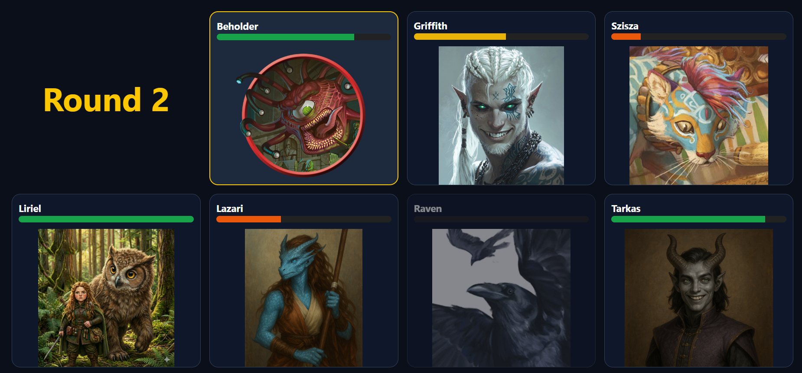
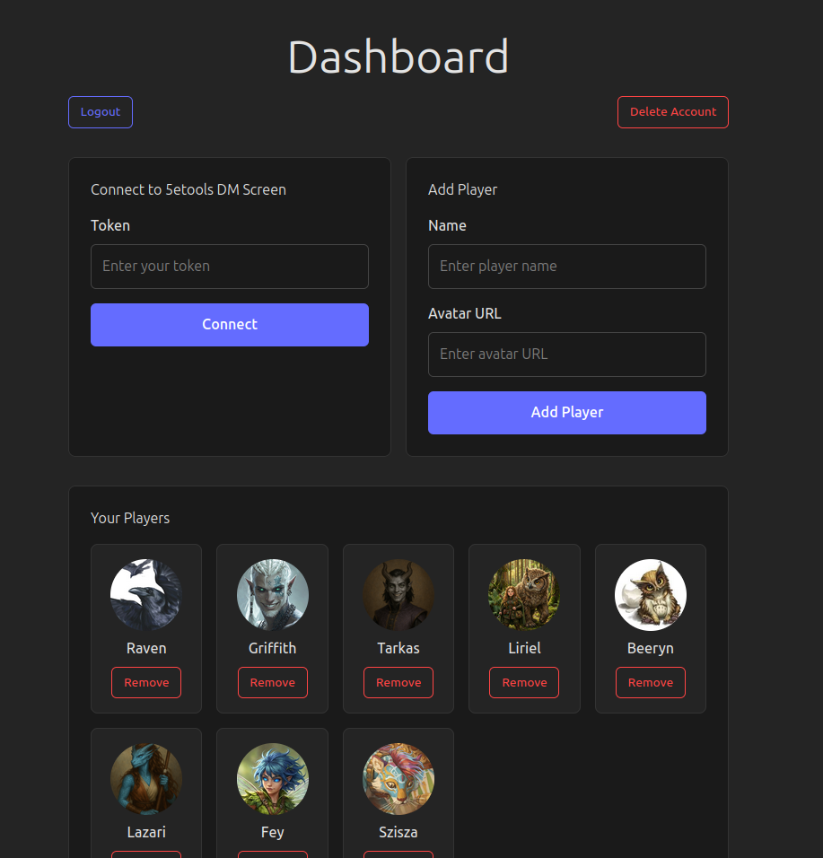
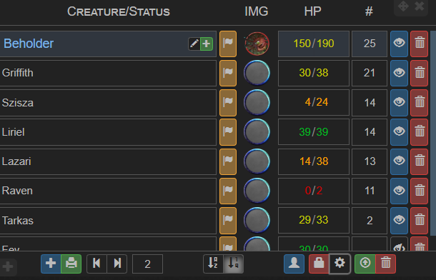

# Encountr

This tool allows you to have a displayable version for encounters tracked on [5etools DM Screen](https://5e.tools/dmscreen.html).

Using 5etools' DM Screen, you will be able to have the page display information from the encounter, such as:
- Current Round
- Current creature on turn
- Initiative order
- Health status of each player
  - If wanted, can show exact HP (see below)
- Health status of each monster
  - If wanted, can show exact HP (see below)
- Pictures for each combatant (PC and monsters)
  - Monsters missing a picture (e.g. homebrew) can get one from the DM Screen (see [Monster Pictures](#monster-pictures))

## How To Use
### If you would like to use the local app, where you do not need to register, head over to [Local repo](https://github.com/srchd/dnd-5etools-encounter-display)

#### Dashboard:

1. Create an account (this is needed to save your players, guest mode will be coming soon)
2. Add your players:
   - Name
   - Avatar URL (currently manual uploads are not supported)
3. Go to [5etools DM Screen](https://5e.tools/dmscreen.html)
4. Add an **Initiative Tracker** element to the screen
5. Click on the  icon
6. Select Standard
7. Start Server
8. Copy token
9. Paste token in the input field at the Dashboard and press **Connect**

## Customization Options

If you do not wish to show a monster (yet), you can disable it from the display, by hiding it in 5etools' DM Screen just by clicking on the eye icon. If it is crossed, it will not show up.

By default, 5etools' DM Screen does not send the exact HP of each creature. The application will show the status of the monster and/or player
if the settings is not changed. If needed to show the exat HP, turn on these settings in the Initiative Tracker settings **(gear icon on the bottom right)**:
  - Player View: Show exact player HP
  - Player View: Show exact monster HP

**Note:** By default, players' HP is not filled out. If the DM is not tracking it on the DM Screen, it will always show like they at full health.

## Monster Pictures
By default, each monster's picture is loaded from 5etools' token images (`https://5e.tools/img/bestiary/tokens/XMM/<monster name>.webp`). Some monsters, mostly homebrew ones, have their pictures stored elsewhere, so they appear without one.

To fix this, the DM can "show" a picture from the DM Screen, and the display assigns it to a monster.

### Setup
Add an **Image** column to the Initiative Tracker in the DM Screen (Initiative Tracker settings, **gear icon on the bottom right** -> **Additional Columns** -> **General** -> **Image**). Without this column, no "show image" button is available, so pictures cannot be sent to the display.

### How the picture is assigned
When the DM shows a picture, the display picks the monster in this order:
1. **Matching name:** if the picture's file name matches a monster's name (e.g. `bestiary/AI/Splugoth the Returned.webp` → *Splugoth the Returned*), it goes to that monster. This is usually the case for pictures hosted on 5etools.
2. **Active monster without a picture:** if the monster currently on turn has no picture, it gets it.
3. **The only monster without a picture:** if exactly one monster has no picture, it gets it, no matter who is currently on turn (a player or another monster).

If none of these apply (e.g. several monsters lack a picture and none of them is on turn), the picture is ignored. Show it again when the right monster is on turn.

Both 5etools-hosted pictures and external pictures (e.g. D&D Beyond URLs) are supported. External pictures usually have file names that do not match the monster's name, so they rely on rules 2 and 3.

Once assigned, a picture stays with that monster for the rest of the session, even when the encounter updates. Reloading the display page resets the assigned pictures.

**Note:** Monster names must match exactly. If the DM Screen numbers copies of the same monster (e.g. *Goblin 2*), each copy is treated as a separate monster.

## Troubleshooting/FAQ:
1. Monsters are not showing:
   - Make sure that the "eye" icon is not crossed out in the DM Screen.
2. A monster has no picture:
   - Make sure the Initiative Tracker has an **Image** column, then show the monster's picture from the DM Screen (see [Monster Pictures](#monster-pictures)).
   - If several monsters lack a picture, show the picture while that monster is on turn.
3. A shown picture did not appear:
   - Assignment is skipped if the display cannot tell which monster the picture belongs to. Show it again while the monster is on turn.

If you face a problem which is not detailed here, raise an issue.
